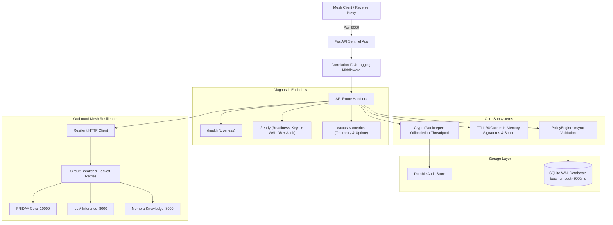

# Project: Sentinel Tier-1 Production Excellence

## Architecture
Sentinel is an autonomous cybersecurity watchdog, cryptographic signing gatekeeper, and tamper-detection microservice within the FRIDAY Universe mesh (`friday_mesh` Docker bridge network on Oracle Cloud Always Free).
- Framework: FastAPI (asynchronous ASGI), Uvicorn.
- Internal Port: 8000, Host Port: 8007 (`8007:8000`), Route: `https://friday-universe.duckdns.org/sentinel/*`.
- Storage: SQLite in WAL mode (`PRAGMA journal_mode=WAL; PRAGMA busy_timeout=5000;`) via SQLAlchemy / aiosqlite and durable JSONL audit stores.
- Resilience: Connection-pooled asynchronous HTTP client (`httpx.AsyncClient`), circuit breakers with exponential backoff and jitter, graceful fallbacks for upstream mesh services (FRIDAY Core, LLM gateways, Memora, IntelX).
- Security: Non-root container (`appuser` UID 1000), zero-trust startup validation, Pydantic request/response validation, correlation ID tracking, and standardized error envelopes.



## Feature Inventory
| # | Feature | Description | Milestone | Source |
|---|---------|-------------|-----------|--------|
| 1 | Non-blocking Crypto Offloading | Offload CPU-bound ECDSA signing/verification and audit verification to thread pool | M1 | Survey 1 (R1) |
| 2 | Non-blocking Outbound Fallbacks | Replace synchronous `urllib.request.urlopen` in `memora_cloud_fallback.py` with async client | M1 | Survey 1 (R1) |
| 3 | Shared Pooled Async HTTP Client | Provide application-scoped connection-pooled `httpx.AsyncClient` lifecycle | M1 | Survey 1 (R1) |
| 4 | SQLite WAL Mode & Busy Timeout | Attach connect listeners for `PRAGMA journal_mode=WAL;` and `busy_timeout=5000;` on all engines | M1 | Survey 2 (R4) |
| 5 | In-Memory TTLLRUCache | Implement thread-safe bounded `TTLLRUCache` for signature verification and scope containment | M1 | Survey 2 (R4) |
| 6 | Circuit Breaker Pattern | Implement three-state circuit breaker (Closed, Open, Half-Open) with failure thresholds | M2 | Survey 1 (R2) |
| 7 | Exponential Backoff with Jitter | Implement resilient retry helper with full jitter for outbound mesh calls | M2 | Survey 1 (R2) |
| 8 | Resilient Upstream Mesh Calling | Wrap FRIDAY Core, LLM inference, Memora, and IntelX calls with circuit breaker and retries | M2 | Survey 1 (R2) |
| 9 | Upstream Graceful Degradation | Fall back gracefully to cached/structured state on upstream outages without unhandled 500s | M2 | Survey 1 (R2) |
| 10 | Standardized Diagnostic Endpoints | Implement/harden `/health`, `/ready`, `/status`, and `/metrics` live telemetry | M3 | Survey 1 (R3) |
| 11 | Structured Logging & Correlation IDs | Correlation ID extraction middleware (`X-Correlation-ID`) and structured log formatting | M3 | Survey 1 (R3) |
| 12 | Standardized Error Envelope | Ensure consistent error responses `{"error": "...", "message": "...", "detail": "...", "success": false}` | M3 | Survey 1 (R3) |
| 13 | Zero-Trust Startup Validation | Validate critical security secrets in production and fail fast with actionable guidance | M3 | Survey 2 (R5) |
| 14 | Container Governance & Signal Handling | Fix SIGTERM signal interception in `main.py` and ensure graceful shutdown within 5 seconds | M3 | Survey 2 (R5) |
| 15 | High-Yield Module Coverage Expansion | Add unit tests for `threat_context.py`, `threat_intel`, `storage.py`, `session.py`, `correlation.py` | M4 | Survey 3 (R6) |
| 16 | Resilience & Diagnostics Test Suite | Add unit tests for circuit breaker, retry, cache, `/ready`, `/status`, and telemetry | M4 | Survey 3 (R6) |
| 17 | 85%+ Overall Code Coverage | Achieve and verify >=85.0% coverage across the `sentinel` package | M4 | Survey 3 (R6) |
| 18 | CI/CD Coverage Gate Hardening | Add `--cov-fail-under=85` to `.github/workflows/ci.yml` | M5 | Survey 3 (R7) |
| 19 | Architecture & Deployment Documentation | Update `README.md` with Mermaid diagrams, endpoints, and `.env.example` with resilience vars | M5 | Survey 3 (R7) |
| 20 | Final Integrity & Clean Commit Verification | Run `ruff check .`, `verify_diary.py`, and commit clean working tree | M5 | Survey 3 (R7) |

## Milestones
| # | Name | Scope | Dependencies | Status |
|---|------|-------|-------------|--------|
| M1 | Async & Database Foundations | Crypto offloading, non-blocking outbound, SQLite WAL mode + busy timeout, TTLLRUCache | none | IN_PROGRESS |
| M2 | Resilience & Circuit Breakers | Circuit breaker, retry with jitter, resilient mesh calling (FRIDAY Core, LLM, Memora), fallbacks | M1 | PLANNED |
| M3 | Diagnostics, Logging & Governance | `/ready`, `/status`, `/metrics`, correlation IDs, standard error envelope, zero-trust validator, clean shutdown | M1, M2 | PLANNED |
| M4 | Comprehensive Testing & Coverage | Unit tests for 5 high-yield modules, resilience, cache, diagnostics; reach >=85.0% coverage | M1, M2, M3 | PLANNED |
| M5 | Documentation, CI/CD & Final Gate | CI workflow `--cov-fail-under=85`, README.md, .env.example, ruff check, verify_diary | M4 | PLANNED |

## Interface Contracts

### 1. In-Memory Cache Contract (`sentinel/core/cache/ttl_lru_cache.py`)
```python
class TTLLRUCache[K, V]:
    def __init__(self, maxsize: int = 1000, ttl_seconds: float = 300.0) -> None: ...
    def get(self, key: K) -> Optional[V]: ...
    def set(self, key: K, value: V, ttl_seconds: Optional[float] = None) -> None: ...
    def clear(self) -> None: ...
    def stats(self) -> dict[str, int]: ...
```

### 2. Resilience Contract (`sentinel/core/resilience/circuit_breaker.py`)
```python
class CircuitState(str, Enum):
    CLOSED = "closed"
    OPEN = "open"
    HALF_OPEN = "half_open"

class CircuitBreaker:
    def __init__(self, failure_threshold: int = 5, recovery_timeout: float = 30.0, expected_exceptions: tuple = (Exception,)) -> None: ...
    async def call[T](self, func: Callable[..., Awaitable[T]], *args, **kwargs) -> T: ...
    def get_state(self) -> CircuitState: ...
    def get_metrics(self) -> dict[str, Any]: ...
```

### 3. Diagnostic Response Contracts (`sentinel/apps/api/main.py`)
- `/health`: `{"status": "ok", "service": "sentinel", "evidence_class": "operational"}`
- `/ready`: `{"status": "ready", "service": "sentinel", "checks": {"crypto_keys": true, "database_wal": true, "audit_integrity": true}}` (HTTP 200 when healthy, HTTP 503 when degraded)
- `/status` and `/metrics`: `{"service": "sentinel", "uptime_seconds": float, "requests_total": int, "errors_total": int, "subsystems": {...}}`
- Error Envelope: `{"error": str, "message": str, "detail": str, "success": false}`

## Code Layout
- `sentinel/core/cache/ttl_lru_cache.py`: Thread-safe bounded TTL/LRU cache implementation
- `sentinel/core/resilience/circuit_breaker.py`: Three-state circuit breaker
- `sentinel/core/resilience/retry.py`: Exponential backoff with full jitter
- `sentinel/core/crypto/crypto_gatekeeper.py`: Cryptographic gatekeeper with threadpool offloading & caching
- `sentinel/storage/database/session.py`: Database engine with SQLite WAL & busy_timeout listeners
- `sentinel/storage/persistence/durable_store.py`: Durable storage with WAL mode & clean closing
- `sentinel/apps/api/main.py`: FastAPI application, diagnostic endpoints, lifespan management, correlation ID middleware
- `sentinel/config/validator.py`: Zero-trust startup environment validation
- `tests/unit/`: Pytest unit tests for all modules
