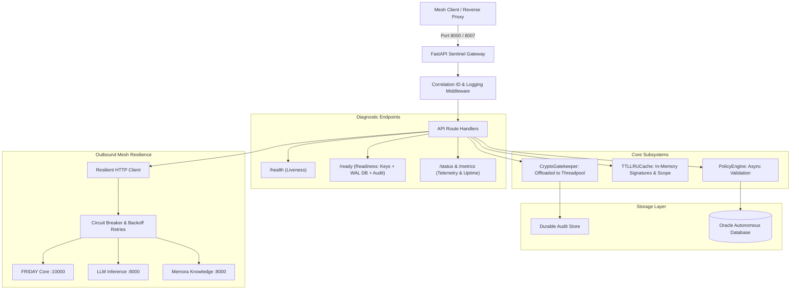

# 🛡️ Sentinel — Autonomous Cybersecurity Watchdog & Cryptographic Signing Gatekeeper

> **Identity:** Sentinel (Security Specialist Agent)  
> **Ecosystem:** FRIDAY Universe  
> **Production Target:** Oracle Cloud Always Free (`https://friday-universe.duckdns.org/sentinel/*`)  
> **Container Mesh:** `friday_mesh` (Docker Internal Network)  

---

## 🏛️ 1. Role & Scope

**Sentinel** is the dedicated autonomous cybersecurity watchdog, cryptographic signing gatekeeper, and tamper-detection specialist of the FRIDAY Universe. It guarantees ecosystem-wide zero trust across inter-agent communications, automated vulnerability intelligence, and tamper-evident audit durability.

### Core Responsibilities:
1. **Cryptographic Signing Authority**: Issues and validates HMAC-SHA256 and ECDSA (SECP256R1) cryptographic envelopes across all 9 peer agents in the ecosystem.
2. **Tamper-Evident Audit Logging**: Maintains an append-only, cryptographic hash-chain ledger (`logs/audit.jsonl`) verifying sequence continuity and signature authenticity.
3. **Scoped Capability Tokens**: Mints and validates short-lived, actor-bound, and resource-scoped access capabilities (`/api/v1/capabilities/*`).
4. **Autonomous Threat & Vulnerability Watchdog**: Continuous attack surface discovery, network boundary mapping, CVE intelligence correlation, and kill-switch policy governance.
5. **Ecosystem Gatekeeper**: Intercepts high-impact offensive maneuvers, requiring explicit human operator review and immutable justification recording.

---

## 🌐 2. Universe Infrastructure & Topology

The FRIDAY Universe operates on Oracle Cloud Always Free (2 OCPUs, 12 GB RAM Ampere A1 ARM64 / AMD x86_64 host) within a private container mesh (`friday_mesh`) with automated HTTPS termination via Caddy reverse proxy:

| Parameter | Configuration | Notes |
| :--- | :--- | :--- |
| **Internal Container Port** | `8000` | Declared in `Dockerfile` (`EXPOSE 8000`) |
| **Host Port Mapping** | `8007` | Production mapping: `8007:8000` |
| **Direct Mesh URL** | `http://sentinel:8000` | Accessible by peer agents within `friday_mesh` |
| **Public Gateway Route** | `https://friday-universe.duckdns.org/sentinel/*` | Handled by Caddy with automatic SSL |
| **Central Ecosystem Gateway**| `http://friday:10000` | FRIDAY Core OS & Task Orchestrator |
| **Runtime Base** | Python 3.11-slim | Runs under non-root user `appuser` (UID 1000) |
| **Healthcheck Route** | `/health` (`http://localhost:8000/health`) | Process liveness, audit validation, and engine health |
| **Readiness Route** | `/ready` (`http://localhost:8000/ready`) | Cryptographic key, SQLite WAL DB, and audit checks |
| **Telemetry Route** | `/status` (`http://localhost:8000/status`) | Uptime, request & error metrics, circuit breaker states |

### Microservice Architecture



---

## 🔐 3. Cryptographic Protocol Specification

All peer communications within the FRIDAY Universe requiring authoritative non-repudiation and tamper prevention are sealed using cryptographic envelopes.

### HMAC-SHA256 Signature Header Protocol:
Inter-agent requests sent with cryptographic headers adhere to the following contract:

```http
POST /api/v1/sentinel/gate/review HTTP/1.1
Host: friday-universe.duckdns.org
X-API-Key: <SENTINEL_API_KEY>
X-Service-Identity: friday
X-Signature-Algorithm: HMAC-SHA256
X-Signature: c331ee98f1fcf3de2cda57da89cbbed230284a59db94af9709253c4cb959f60c
X-Payload-Hash: 1904528facb543757e36493a8910be69d9627a95a04f62431496e98835368f11
X-Request-Timestamp: 2026-10-14T16:15:00.000000+00:00
X-Request-Nonce: 4f98e6a1-02ab-4dc9-83c9-0268a23d52a2
Content-Type: application/json

{"action": "quarantine", "subject": "compromised_node_14"}
```

### Signature Generation & Envelope Verification:
1. **Canonicalization**: Payloads are serialized deterministically (`json.dumps(payload, sort_keys=True, separators=(',', ':'))`).
2. **Hashing**: SHA-256 digest is computed over canonical bytes.
3. **Signing**: 
   - **HMAC-SHA256**: Keyed hash generated using `SENTINEL_AUDIT_HMAC_KEY`.
   - **ECDSA-SHA256**: ASN.1 DER signature generated over the digest using SECP256R1 private key, exported as Base64.
4. **Verification**: Validated using constant-time comparison (`hmac.compare_digest`) or ECDSA public key verification.

---

## 📡 4. Core API Specification

### 4.1 Process Liveness & Security Engine Health (`/health`)

Checks process liveness, audit log ledger integrity, and engine readiness.

* **Method**: `GET`
* **Path**: `/health`

#### Example Request:
```bash
curl -s -X GET "https://friday-universe.duckdns.org/sentinel/health"
```

#### Example Response (200 OK):
```json
{
  "status": "ok",
  "service": "sentinel",
  "evidence_class": "process_liveness",
  "observed_at": "2026-10-14T16:20:00.000000+00:00",
  "security_engine": "active",
  "version": "1.0.0",
  "environment": "production",
  "kill_switch_active": false,
  "audit_chain_valid": true,
  "audit_evidence_class": "audit_chain_integrity_check",
  "audit_chain_entries": 42,
  "audit_chain_vacuous": false,
  "audit_durable": true,
  "audit_persistence_evidence": "durable_store_configured"
}
```

---

### 4.2 Readiness Probe (`/ready`)

Verifies that essential subsystems (cryptographic signing keys, Oracle Autonomous Database storage, audit hash continuity) are fully initialized before routing mesh traffic.

* **Method**: `GET`
* **Path**: `/ready` (also `/api/v1/ready`)

#### Example Request:
```bash
curl -s -X GET "https://friday-universe.duckdns.org/sentinel/ready"
```

#### Example Response (200 OK when ready):
```json
{
  "status": "READY",
  "ready": true,
  "evidence_class": "local_readiness_checks",
  "observed_at": "2026-10-14T16:20:00.000000+00:00",
  "checks": {
    "crypto_keys": true,
    "database_wal": true,
    "audit_integrity": true,
    "event_bus_initialized": true,
    "storage_backend_configured": true,
    "audit_durable": true
  },
  "modules_active": 8,
  "event_bus": "LocalEventBus",
  "storage_backend": "oracle",
  "peer_connectivity": "not_checked"
}
```

---

### 4.3 Diagnostic Telemetry & Operational Status (`/status`)

Exposes real-time diagnostic telemetry, uptime, error counters, cache statistics, and circuit breaker metrics.

* **Method**: `GET`
* **Path**: `/status` (also `/api/v1/status`)

#### Example Request:
```bash
curl -s -X GET "https://friday-universe.duckdns.org/sentinel/status"
```

#### Example Response (200 OK):
```json
{
  "status": "operational",
  "service": "sentinel",
  "version": "2.0.0",
  "environment": "production",
  "uptime_seconds": 3612.45,
  "started_at": "2026-10-14T15:00:00.000000+00:00",
  "observed_at": "2026-10-14T16:00:12.450000+00:00",
  "requests_total": 1420,
  "errors_total": 0,
  "subsystems": {
    "cryptographic_gatekeeper": "active",
    "verification_cache": {
      "size": 34,
      "maxsize": 2000,
      "hits": 312,
      "misses": 34,
      "hit_ratio": 0.9017
    },
    "mesh_circuit_breakers": [
      {
        "name": "mesh_friday:10000",
        "state": "closed",
        "failure_count": 0,
        "total_calls": 84
      }
    ],
    "audit_engine": "valid"
  }
}
```

---

### 4.4 Cryptographic Signing (`/sign`)

Signs an inter-agent payload using HMAC-SHA256 or ECDSA-SHA256 and records the event in the audit log.

* **Method**: `POST`
* **Path**: `/sign` (also `/api/v1/sign`)
* **Headers**: `Content-Type: application/json`

#### Example Request:
```bash
curl -s -X POST "https://friday-universe.duckdns.org/sentinel/sign" \
  -H "Content-Type: application/json" \
  -H "X-API-Key: ${SENTINEL_API_KEY}" \
  -d '{
    "payload": {
      "command": "remediate_cve",
      "target": "database_node_01",
      "severity": "CRITICAL"
    },
    "algorithm": "HMAC-SHA256",
    "caller_id": "friday"
  }'
```

#### Example Response (200 OK):
```json
{
  "status": "success",
  "algorithm": "HMAC-SHA256",
  "signature": "a9611c1b84785bac4db66c6aabd87e7e46f0277f9734f5e6b6e81759d6027b7b",
  "payload_hash": "4e16219b678ab2d3fc977a30224e2fce3a82ea8fa0268a23d52a27a8aee186a7",
  "timestamp": "2026-10-14T16:20:05.123456+00:00",
  "signer": "sentinel",
  "caller_id": "friday",
  "key_id": "default"
}
```

---

### 4.3 Cryptographic Verification (`/verify`)

Verifies the cryptographic envelope and integrity of a signed payload.

* **Method**: `POST`
* **Path**: `/verify` (also `/api/v1/verify`)
* **Headers**: `Content-Type: application/json`

#### Example Request:
```bash
curl -s -X POST "https://friday-universe.duckdns.org/sentinel/verify" \
  -H "Content-Type: application/json" \
  -d '{
    "payload": {
      "command": "remediate_cve",
      "target": "database_node_01",
      "severity": "CRITICAL"
    },
    "signature": "a9611c1b84785bac4db66c6aabd87e7e46f0277f9734f5e6b6e81759d6027b7b",
    "algorithm": "HMAC-SHA256"
  }'
```

#### Example Response (200 OK):
```json
{
  "valid": true,
  "algorithm": "HMAC-SHA256",
  "payload_hash": "4e16219b678ab2d3fc977a30224e2fce3a82ea8fa0268a23d52a27a8aee186a7",
  "verified_at": "2026-10-14T16:20:08.654321+00:00",
  "signer": "sentinel",
  "error": null
}
```

---

### 4.4 Tamper-Evident Audit Ledger Status (`/audit`)

Inspects the cryptographic sequence, hash chain validity, and durable storage backing.

* **Method**: `GET`
* **Path**: `/audit` (also `/api/v1/audit`)

#### Example Request:
```bash
curl -s -X GET "https://friday-universe.duckdns.org/sentinel/audit"
```

#### Example Response (200 OK):
```json
{
  "status": "ok",
  "service": "sentinel",
  "evidence_class": "audit_chain_integrity_check",
  "chain_valid": true,
  "entry_count": 42,
  "last_hash": "2c02a453f438ed5b91e51ce87b4343a1a1d9695f51849bf02496c0f02f9adae2",
  "storage_backend": "oracle",
  "storage_durable": true,
  "observed_at": "2026-10-14T16:20:12.000000+00:00"
}
```

---

## ⚙️ 5. Environment Variables Reference

| Variable | Type | Default | Description |
| :--- | :--- | :--- | :--- |
| `PORT` | Integer | `8000` | Port uvicorn binds to inside container |
| `HOST` | String | `0.0.0.0` | Listen host interface |
| `SENTINEL_ENVIRONMENT` | String | `production` | Environment tier (`production`, `staging`, `testing`) |
| `SENTINEL_DEBUG` | Boolean | `false` | Enable verbose debugging (disabled in production) |
| `SENTINEL_API_AUTH_REQUIRED` | Boolean | `true` | Enforces API authentication on protected endpoints |
| `SENTINEL_API_KEY` | String (Secret) | — | 32+ char key for authenticating incoming API requests |
| `SENTINEL_AUDIT_HMAC_KEY` | String (Secret) | — | Master HMAC key for signing audit blocks & envelopes |
| `SENTINEL_AUDIT_SIGNING_KEY` | String (Secret) | — | Alias/fallback for `SENTINEL_AUDIT_HMAC_KEY` |
| `SENTINEL_CAPABILITY_SIGNING_KEY` | String (Secret) | — | 32+ char key for capability token authentication |
| `SENTINEL_ECDSA_PRIVATE_KEY` | String (Secret) | *(derived)* | Optional PEM-encoded ECDSA SECP256R1 private key |
| `SENTINEL_STORAGE_BACKEND` | String | `oracle` | Persistence backend: `oracle` (durable) or `memory` (tests only). SQLite is rejected and PostgreSQL is legacy/unsupported. |
| `SENTINEL_DATABASE_URL` | String (Secret) | — | Oracle Autonomous Database DSN (`SENTINEL` login/schema). PostgreSQL and SQLite are not supported. |
| `SENTINEL_ORACLE_DSN` | String (Secret) | — | Alternative to `SENTINEL_DATABASE_URL`; wallet-based Oracle DSN |
| `SENTINEL_ORACLE_HOST` / `SENTINEL_ORACLE_SERVICE_NAME` | String | — | Oracle coordinates when no full DSN is supplied |
| `SENTINEL_ORACLE_USER` / `SENTINEL_ORACLE_PASSWORD` | String (Secret) | — | Oracle login for the `SENTINEL` schema |
| `SENTINEL_S3_BACKEND` | String | `s3` | Evidence artifact backend: `s3` or `local` |
| `SENTINEL_S3_ENDPOINT` | String | `minio:9000` | S3/MinIO service endpoint |
| `SENTINEL_S3_BUCKET_NAME` | String | `sentinel-evidence` | Evidence bundle object storage bucket |
| `SENTINEL_MAX_HTTP_CONCURRENCY` | Integer | `256` | Maximum concurrent HTTP connections |
| `SENTINEL_MAX_HEALTH_CONCURRENCY` | Integer | `16` | Reserved concurrency budget for `/health` checks |
| `INFERENCE_URL` | String | `http://inference:8000` | Inference Multi-Model Gateway mesh URL |
| `MEMORA_URL` | String | `http://memora:8000` | Memora Cloud Memory mesh URL |
| `FRIDAY_URL` | String | `http://friday:10000` | FRIDAY Core OS central mesh URL |

---

## 🚀 6. Local Development & Testing

### 6.1 Running Tests
```bash
# Run complete test suite with coverage
pytest -v --tb=short

# Verify cryptographic gatekeeper specifically
pytest tests/unit/test_cryptographic_gatekeeper.py -v
```

### 6.2 Running Locally with Docker
```bash
# Copy example configuration
cp .env.example .env

# Start full production stack on port 8007
docker compose -f docker-compose.production.yml up --build -d
```